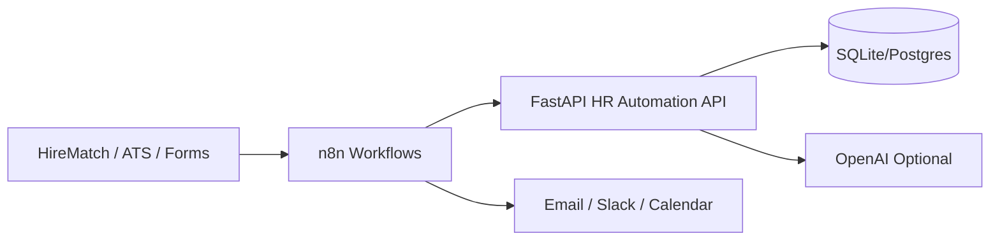

# HR Process Automation (Python + FastAPI + n8n)

Intelligent automation layer for HireMatch-style HR workflows:

- **Resume screening** (AI or heuristic scoring)
- **Interview scheduling** (slot selection + meeting link)
- **Employee onboarding** (auto-generated task checklist)

Built with **FastAPI**, **SQLAlchemy**, and **n8n** orchestration.

## Architecture



## Quick start

### 1. API (local)

```bash
cd hr-automation/api
python -m venv .venv
source .venv/bin/activate
pip install -r requirements.txt
cp ../.env.example .env
uvicorn app.main:app --reload --port 8000
```

Open API docs: http://localhost:8000/docs

### 2. n8n + API (Docker)

```bash
cd hr-automation
cp .env.example .env
docker compose up --build
```

- API: http://localhost:8000
- n8n: http://localhost:5678

Import workflows from `n8n/workflows/*.json`.

## API endpoints

| Area | Method | Path |
|------|--------|------|
| Health | GET | `/health` |
| Screen resume (JSON) | POST | `/api/v1/screening/analyze` |
| Screen resume (file) | POST | `/api/v1/screening/analyze-upload` |
| List screening results | GET | `/api/v1/screening/results` |
| Schedule interview | POST | `/api/v1/interviews/schedule` |
| Upcoming interviews | GET | `/api/v1/interviews/upcoming` |
| Start onboarding | POST | `/api/v1/onboarding/start` |
| Onboarding tasks | GET | `/api/v1/onboarding/tasks/{email}` |
| n8n callback | POST | `/api/v1/webhooks/n8n` |

## Example: resume screening

```bash
curl -X POST http://localhost:8000/api/v1/screening/analyze \
  -H "Content-Type: application/json" \
  -d '{
    "candidate_name": "Pavanvamsi Chimmiri",
    "candidate_email": "pavan@example.com",
    "job_title": "Healthcare AI Documentation Specialist",
    "job_description": "AI-driven documentation, NABH research, dashboards",
    "resume_text": "Experienced in AI automation, Python, FastAPI, HR workflows",
    "min_score_threshold": 60
  }'
```

## Example: interview scheduling

```bash
curl -X POST http://localhost:8000/api/v1/interviews/schedule \
  -H "Content-Type: application/json" \
  -d '{
    "candidate_name": "Pavanvamsi Chimmiri",
    "candidate_email": "pavan@example.com",
    "job_title": "Healthcare AI Documentation Specialist",
    "interviewer_email": "hr@hirematch.test",
    "preferred_slots": ["2026-08-20T10:00:00", "2026-08-21T14:00:00"]
  }'
```

## Example: employee onboarding

```bash
curl -X POST http://localhost:8000/api/v1/onboarding/start \
  -H "Content-Type: application/json" \
  -d '{
    "employee_name": "Pavanvamsi Chimmiri",
    "employee_email": "pavan@example.com",
    "role": "HR Automation Engineer",
    "department": "People Operations",
    "start_date": "2026-09-01"
  }'
```

## n8n integration

1. Start API and n8n (`docker compose up`).
2. Import `n8n/workflows/resume-screening-pipeline.json`.
3. Import `n8n/workflows/employee-onboarding.json`.
4. Activate workflows and use webhook URLs:
   - `POST http://localhost:5678/webhook/hr-new-application`
   - `POST http://localhost:5678/webhook/hr-new-hire`

Set `N8N_WEBHOOK_SECRET` in `.env` and send header `x-n8n-secret` on `/api/v1/webhooks/n8n`.

## HireMatch integration (optional)

Point n8n HTTP nodes at your HireMatch app when a candidate applies or is imported:

1. Trigger n8n from HireMatch (webhook or scheduled poll).
2. n8n calls FastAPI screening.
3. If `recommendation === shortlist`, n8n schedules interview and notifies HR.

## Environment variables

See `.env.example`.

## Tests

```bash
cd hr-automation/api
bash ../scripts/smoke-test.sh
```
