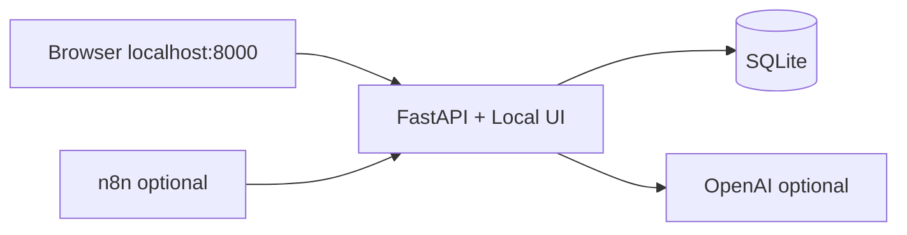

# HireMatch HR Automation — Local Pack

Downloadable pack for **resume screening**, **interview scheduling**, and **employee onboarding**.

Runs as a **local website** on your machine. No Supabase. No cloud account required for the demo.

---

## Download & run (anyone)

### Option A — From this repo

```bash
# Clone (or download ZIP from GitHub → Code → Download ZIP)
git clone https://github.com/pavanvamsi-chimmiri/HireMatch.git
cd HireMatch/hr-automation

chmod +x start.sh
./start.sh
```

Open **http://localhost:8000**

**Windows:** double-click `start.bat` instead of `./start.sh`.

### Option B — Packaged zip (share with teammates)

Maintainers can build a zip:

```bash
cd hr-automation
chmod +x pack.sh
./pack.sh
# → dist/hirematch-hr-automation-local-YYYYMMDD.zip
```

Recipients:

1. Unzip  
2. Run `./start.sh` (Mac/Linux) or `start.bat` (Windows)  
3. Open http://localhost:8000  

Read `HOW_TO_RUN.txt` inside the zip.

---

## What you get

| URL | Purpose |
|-----|---------|
| http://localhost:8000 | **Local website** — screen / schedule / onboard |
| http://localhost:8000/docs | Swagger API explorer |
| http://localhost:8000/health | Health check |
| http://localhost:5678 | n8n (only with `./start.sh --docker`) |

- Works **offline** with heuristic scoring if `OPENAI_API_KEY` is empty  
- Optional AI scoring when you set `OPENAI_API_KEY` in `.env`

---

## Requirements

| Mode | Need |
|------|------|
| Default (`./start.sh`) | **Python 3.11, 3.12, or 3.13** (not 3.14 yet) |
| Docker (`./start.sh --docker`) | **Docker Desktop** |

### Mac tip (if you see `pydantic-core` / Python 3.14 errors)

```bash
brew install python@3.12
cd hr-automation
rm -rf api/.venv
./start.sh
```

`start.sh` prefers `python3.12` / `python3.13` / `python3.11` automatically.

---

## Docker (API + n8n)

```bash
./start.sh --docker
# or: docker compose up --build
```

Import workflows from `n8n/workflows/*.json` into n8n.  
Inside Docker, workflows call `http://hr-automation-api:8000` (already set in the JSON).

Stop:

```bash
docker compose down
```

---

## Architecture



---

## API endpoints

| Area | Method | Path |
|------|--------|------|
| Health | GET | `/health` |
| Screen resume (JSON) | POST | `/api/v1/screening/analyze` |
| Screen resume (file) | POST | `/api/v1/screening/analyze-upload` |
| List screening results | GET | `/api/v1/screening/results` |
| Schedule interview | POST | `/api/v1/interviews/schedule` |
| Upcoming interviews | GET | `/api/v1/interviews/upcoming` |
| Start onboarding | POST | `/api/v1/onboarding/start` |
| Onboarding tasks | GET | `/api/v1/onboarding/tasks/{email}` |
| n8n callback | POST | `/api/v1/webhooks/n8n` |

---

## Smoke test

With the server running:

```bash
bash scripts/smoke-test.sh
```

---

## Environment

Copy `.env.example` → `.env` (done automatically by `start.sh`).

| Variable | Required | Notes |
|----------|----------|--------|
| `OPENAI_API_KEY` | No | Enables AI scoring |
| `N8N_WEBHOOK_SECRET` | For n8n webhooks | Header `x-n8n-secret` |
| `DATABASE_URL` | No | Defaults to local SQLite |
| `CORS_ORIGINS` | No | Comma-separated origins |

---

## HireMatch Next.js app (separate)

The full HireMatch dashboard (auth, jobs, applicants) is the Next.js app at the repo root and needs Supabase.  
This **local pack** is the standalone automation layer — share the zip when you only need HR workflows + a simple UI.
